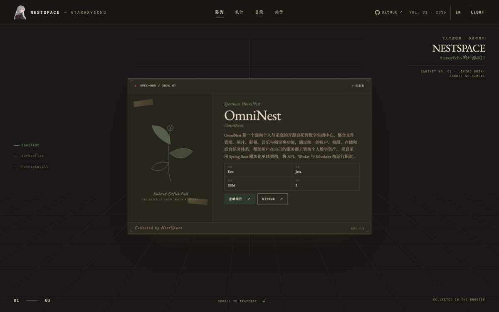
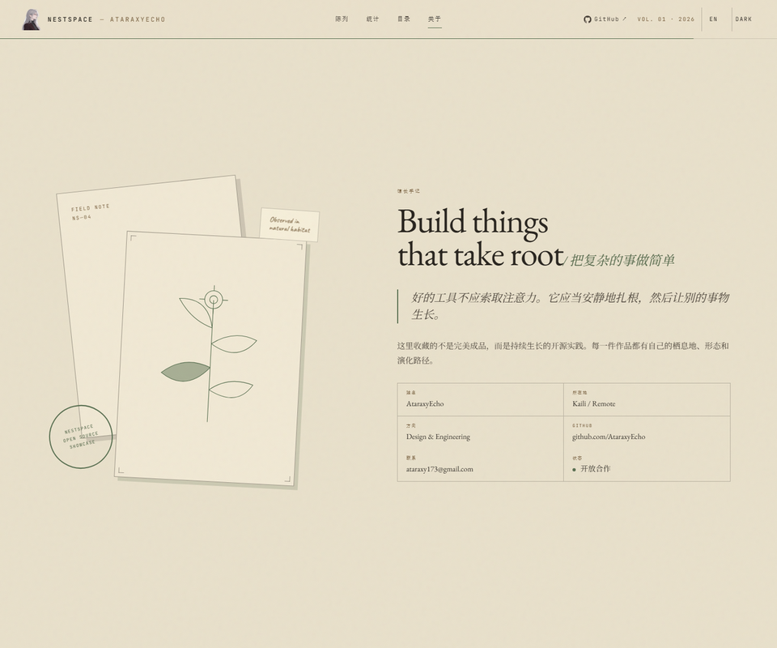
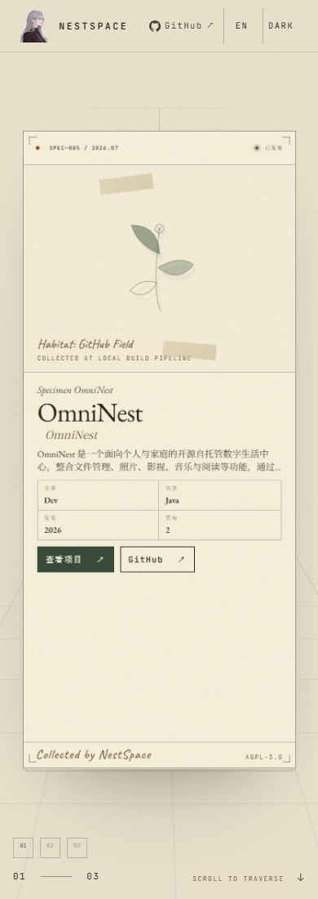
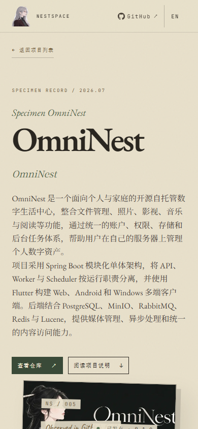

<p align="center">
  
</p>

# NestSpace

**在线预览：<https://nestspace.online/>**

记录自己在用的开源项目：每个项目写清做什么、怎么装、现在什么状态。对外是只读展示站，对内是一个后台。
没有常驻服务器——`git push` 即部署，成本是 Cloudflare 的免费额度而不是账单。

[](LICENSE)
[](https://nestspace.online/)


| 层 | 选型 |
|---|---|
| 前端 | React 19 · Vite 8 · Tailwind v4 → 静态资产 `frontend/dist` |
| 后端 | Cloudflare Workers + Hono（`frontend/worker/index.ts`）：公开只读 API、管理端 API、SEO 注入 |
| 数据 | D1（边缘 SQLite）：项目、站点文案、访问台账 |
| 后台 | 同源的 `/admin`；真实域名下跳到 `admin.<主域>`（地址按 hostname 推导，不写死域名），本地与 workers.dev 就地 |

---

## 预览

桌面：

| 陈列（浅色） | 详情页 |
|---|---|
|  |  |
| 陈列（深色） | 关于 / 手记 |
|  |  |

手机（390px）：

| 首页 | 详情页 |
|---|---|
|  |  |

线上实拍（桌面与手机）；支持深浅主题、中英切换与移动端。

---

## 快速开始（以 Cloudflare 为例）

需要：**Node ≥ 22.18**、**pnpm 10.34.3**（`frontend/package.json` 的 `packageManager` 与 `.mise.toml` 双重钉住）、
一个免费 Cloudflare 账号。**wrangler 已钉在 `frontend` 的 `devDependencies`（4.148.0）**：`pnpm install` 之后
`npx wrangler` 与仓库里的脚本都会用到这份本地二进制，迁移与部署不再依赖机器上的全局版本。

```bash
# 本地跑起来（不需要 Cloudflare 账号）
git clone https://github.com/AtaraxyEcho/NestSpace.git && cd NestSpace
cp frontend/.dev.vars.example frontend/.dev.vars    # ADMIN_SECRET_KEY 填 `openssl rand -base64 32`
bash scripts/d1-migrate.sh local                    # 0001–0017，首次会自建本地库
cd frontend && pnpm install --frozen-lockfile
pnpm run build && npx wrangler dev                  # localhost:8787，管理端 /admin
```

**上线：两种形态，都只用免费额度，代码不用改。**

| | 无域名 · `workers.dev` | 自定义域名（推荐） |
|---|---|---|
| 开启 | `workers_dev = true` | 绑主域 + `admin.<主域>` |
| 后台 | `/admin`（就地渲染） | `admin.<主域>` |
| 代价 | 后台与公开站同源，只剩口令一层 | 多一层 DNS + Access 配置 |

```bash
# 先迁移，再部署；顺序反了公开接口会整片 500
npx wrangler login
npx wrangler d1 create nestspace-prod               # 把 database_id 填进 frontend/wrangler.toml
npx wrangler secret put ADMIN_SECRET_KEY
bash ../scripts/d1-migrate.sh remote                # 可反复执行，只跑没跑过的
npx wrangler deploy
```

无域名模式只需把 `frontend/wrangler.toml` 的 `workers_dev` 改成 `true`（默认 `false`，所以部署完没有 URL），
地址是 `https://nestspace.<账号子域>.workers.dev`；以后绑了自定义域名记得改回去，别留备用入口。

**本地与线上不互通**：数据（本地 `.wrangler/state` vs 远程 D1）与密钥（`.dev.vars` vs `wrangler secret`）
是两套，跑过 `d1-migrate.sh local` 不等于线上也迁移过。

自动部署用 Workers Builds（Root directory 填 `frontend`）。配额边界与运维细节见
[docs/DEPLOYMENT_GUIDE.md](docs/DEPLOYMENT_GUIDE.md)。`0002` 会带进 4 个占位项目
（仓库地址是虚构的 `github.com/nestspace/*`），按需删除或替换。

> [!WARNING]
> **本项目带管理端（可改全站内容），生产务必加一层零信任。** Cloudflare Access 的免费档覆盖最多 50 个用户：
> 自定义域名下把 `/admin` 与 `/api/admin/*` 放进 Access 应用；无域名模式可考虑 Worker 级 Access
> （能覆盖 workers.dev，但它的令牌形态与本项目按经典应用级 JWT 写的校验是否一致需实测）。
>
> 只剩口令时（无域名模式），**`ADMIN_SECRET_KEY` 就是唯一闸门**：它长期有效、不自动轮换，客户端把它放在当前
> 标签页的 sessionStorage 里（任何 XSS 都能读走），代码里的失败锁定只活在单个 isolate、挡不住多 IP 轮换的爆破
> ——安全性完全取决于熵。所以：`openssl rand -base64 32` 生成、只经 `wrangler secret put` 下发、怀疑泄露立即轮换；
> `preview_urls` 保持关闭。密钥本身的实现（不进仓库与响应、常量时间比较）与三层防线的边界见部署手册第三节。

---

## 开发与核对

```bash
cd frontend
pnpm run typecheck   # 前端 / Worker / vite.config 三套 tsconfig
pnpm test            # 19 条闸门（纯函数，不联网）
pnpm run build      # 含 typecheck（Workers Builds 只跑这一条）
bash ../scripts/usage-probe.sh      # 接口探针：自起 8898、自收尾
bash ../scripts/visual-check.sh     # 页面级：无头 Chrome 截图 + DOM 断言（需本机 Chrome）
```

```bash
cd ..                                               # 回到仓库根
bash scripts/verify-production.sh                   # 上线后只读烟测
ADMIN_TOKEN=... bash scripts/verify-production.sh   # 额外确认访问台账可读
bash scripts/d1-backup.sh                           # 备份远程库 + 自动恢复演练
```

---

## 管理端与文案

文案、导航、展示偏好全部在管理端（九个分栏），保存即生效、不用重新部署。两条规则：标题跟随导航名；
留空 = 用内置默认，且默认不会写进库。数据结构改动一律新增 `migrations/NNNN_*.sql`。

访问统计：`POST /api/usage` 收六个白名单事件，落 D1 按天聚合台账（迁移 `0016`）；不存 IP / User-Agent /
来源 URL，UV 由浏览器匿名 ID 经服务端 HMAC 去重——口径是"浏览器"不是"人"。

---

## 仓库结构

```text
frontend/    src/ 前端 · worker/ 后端 · test/ 闸门 · public/ 静态资产
migrations/  D1 建表与种子（0001–0017）
scripts/     migrate · backup · probe · visual-check · verify-production · brand
docs/        DEPLOYMENT_GUIDE.md（部署、安全与配额）· ARCHITECTURE_PLAN.md · plans/
```

---

## 反馈与许可

问题与建议走 [Issues](https://github.com/AtaraxyEcho/NestSpace/issues)。代码与文档采用
**Apache License 2.0**（全文见 [`LICENSE`](LICENSE)）。
